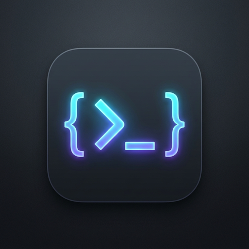

# T3 Code for Home Assistant (`t3-ha-app`)

<div align="center">
  
  <h2>T3 Code Home Assistant Add-on</h2>
  <p><b>Lightweight AI-Assisted Coding Terminal, T3 Code Server, T3 Connect Remote Access & GitHub CLI</b></p>

  [](https://my.home-assistant.io/redirect/supervisor_add_addon_repository/?repository_url=https%3A%2F%2Fgithub.com%2Fmarcohald%2Ft3-ha-app)
  [](https://github.com/marcohald/t3-ha-app/actions/workflows/builder.yaml)
</div>

---

## ✨ Key Features

- 📱 **T3 Code Server with 1-Click Mobile Companion Pairing**:
  - Automatically runs `t3 serve --lan --port 3774` on container startup.
  - Pair directly with the official **T3 Code** companion app for **iOS** (App Store) and **Android** (Google Play).
  - Built-in Ingress pairing modal featuring real-time generated vector QR codes, direct app deep links, and token refresh.
- 🌐 **T3 Connect Cloudflare Remote Access Relay**:
  - Full support for the **T3 Connect** secure relay service (`relay.t3.codes`).
  - Access your Home Assistant coding environment remotely from anywhere without opening firewall or router ports.
  - Interactive management from the Ingress toolbar or directly inside the terminal (`t3 connect status`).
- 🐙 **Integrated GitHub CLI (`gh`)**:
  - Pre-installed official GitHub CLI binary.
  - Clone repositories, push commits, and manage pull requests right from your Home Assistant terminal (`gh auth login`).
- ⚡ **Integrated OpenCode CLI (`opencode`)**:
  - Pre-installed native `opencode` binary, pinned in `opencode-version.txt` (newest stable: `2.3.2`).
  - Mapped to `/data/tools/bin/opencode` on startup so it survives add-on updates, just like `t3` and `claude`.
  - New stable upstream releases are picked up automatically by CI (see below) — no local rebuild needed.
- 🪶 **Optimized Multi-Arch Container Architecture**:
  - Multi-architecture container images (`amd64` and `aarch64` / ARM64) built automatically via GitHub Actions CI.
  - Lightweight base image with minimal memory and disk footprint.
- 🤖 **Automatic T3 Code Release Tracking**:
  - A scheduled workflow (`.github/workflows/track-t3-releases.yaml`) checks `pingdotgg/t3code` every six hours for a new **stable** release.
  - It pins the version in `t3-version.txt`, bumps the add-on version in `config.yaml`, adds a CHANGELOG entry, commits and pushes, then builds and publishes the amd64/aarch64 images and their multi-arch manifest itself, verifies both platforms are in the GHCR manifest, and creates the GitHub release.
  - If the image build fails, the version bump is reverted automatically, so the Add-on Store never advertises a version whose image is missing.
  - Version scheme: `1.<T3 minor>.<T3 patch>` — T3 Code `0.1.11` ships as add-on `1.1.11`.
- ⚡ **Automatic OpenCode Release Tracking**:
  - A scheduled workflow (`.github/workflows/track-opencode-releases.yaml`) checks `anomalyco/opencode` every six hours for a new **stable** v2 CLI release.
  - It pins the version in `opencode-version.txt`, bumps the add-on version in `config.yaml`, adds a CHANGELOG entry, then builds, tests and publishes the `amd64`/`aarch64` images and their multi-arch manifest through CI — updates reach the Add-on Store without any local build.
  - Failed builds/tests revert the bump automatically. Supports `workflow_dispatch` with a specific version or `dry_run`. The status view also reports whether a newer OpenCode release is available.
- 💾 **Update-Secure Software Installation (`/data`)**:
  - The container filesystem is rebuilt on every add-on update; only `/data` survives. `persist.sh` points `PATH`, `npm`, `pip`, `cargo`, `go`, `bun` and `deno` at `/data/tools`, so `npm install -g`, `pip install --user`, `cargo install`, … persist across updates. `python3-pip` (`pip3`) is preinstalled in the image.
  - The `t3` binary itself lives on `/data` (`/data/tools/bin/t3`, runtime in `/data/.t3`) and never downgrades, so `t3 update` and `t3 doctor` survive add-on updates. The image copy stays as an offline fallback.
  - Managed instruction blocks in `~/.claude/CLAUDE.md`, `~/.codex/AGENTS.md` and `~/.config/opencode/AGENTS.md` tell every T3 chat to install software into `/data`.
- 🧠 **Bundled Home Assistant Skill**:
  - The [`ha-agent-skill`](https://github.com/marcohald/ha-agent-skill) (`homeassistant`) is vendored in `skill/homeassistant/` and installed to `/data/.claude/skills/homeassistant` on every start.
  - It is symlinked into the Codex, OpenCode, fx/claw and Antigravity skill roots, so every T3 chat can use it.
  - The agent instructions tell T3 to use it for entities, registries, states, dashboards, statistics, history, templates and automations; `HA_URL` and `HA_TOKEN_FILE` are exported for the skill.
  - Verify access from a chat or the terminal with `python3 ~/.claude/skills/homeassistant/scripts/ha_ws.py ping`.
- 🔌 **Home Assistant Domotics & MCP Bridges**:
  - Pre-configured Model Context Protocol (MCP) server endpoints for **Home Assistant Core** and **Zigbee2MQTT**.
  - Direct read/write access to `/config` and `/share` via `/homeassistant`.
- 🖥️ **Streamlined Ingress Terminal UI**:
  - Integrated directly into the Home Assistant sidebar.
  - Multi-session persistent terminal tabs powered by `tmux` (sessions remain active across browser disconnects).
  - Virtual D-Pad navigation (Up, Down, Left, Right, Enter) optimized for touchscreen use.
  - Cleaned, modern top toolbar with fast key shortcuts (`Esc`, `Tab`, `^O`, `🔑 Login`, `🌐 T3 Connect`, `📱 Pair`, `🎮 D-Pad`).
  - Instant dark, light, and auto themes synchronized with your Home Assistant palette.

---

## 🚀 Installation & Add-on Store Setup

### Option 1: 1-Click Store Button (Recommended)
Click the button below to add this repository directly to your Home Assistant Add-on Store:

[](https://my.home-assistant.io/redirect/supervisor_add_addon_repository/?repository_url=https%3A%2F%2Fgithub.com%2Fmarcohald%2Ft3-ha-app)

### Option 2: Manual Repository Addition
1. Open your Home Assistant instance.
2. Go to **Settings** > **Add-ons** > **Add-on Store**.
3. In the top-right corner, click the three dots (**⋮**) > **Repositories**.
4. Add the repository URL:
   ```
   https://github.com/marcohald/t3-ha-app
   ```
5. Click **Add**, then close the dialog.
6. Locate **T3 Code** under the repository list, click **Install**, and toggle **Show in sidebar**.

---

## 📱 Mobile Companion App Pairing

1. Install **T3 Code** on your iOS or Android device.
2. Connect your mobile device to your home Wi-Fi network.
3. Open **T3 Code** from the Home Assistant sidebar.
4. Click the **📱 Pair** button in the top toolbar.
5. Scan the QR code or tap **Copy** to import your credentials into the mobile app.

---

## 🌐 Remote Access with T3 Connect

To connect to your T3 Code instance securely from outside your home network:
1. Open the terminal inside the add-on.
2. Run:
   ```bash
   t3 connect
   ```
3. Complete the quick one-time browser authentication.
4. Monitor tunnel status at any time by clicking **🌐 T3 Connect** in the toolbar or executing `t3 connect status`.

---

## ⚙️ Configuration Reference

| Option | Type | Default | Description |
|---|---|---|---|
| `port` | integer | `3774` | LAN port used by the T3 Code server for local network discovery and companion app pairing. |
| `server_name` | string | *empty* | Custom display and environment name for T3 Code. If empty, the Home Assistant FQDN is used automatically. |
| `ha_token` | string | *empty* | Long-lived access token for Home Assistant Core MCP integration. |
| `mqtt_host` | string | *empty* | MQTT Broker address (e.g. `core-mosquitto`) for Zigbee2MQTT MCP integration. |
| `mqtt_port` | string | `1883` | MQTT Broker port. |
| `mqtt_user` | string | *empty* | MQTT username. |
| `mqtt_pass` | password | *empty* | MQTT password. |

---

## 💾 Data Persistence & Architecture

In strict accordance with the [Home Assistant Add-on Developer Documentation](https://developers.home-assistant.io/docs/add-ons/presentation#data-directory):
- All persistent configuration, keys, session tokens, and T3 data are stored inside `/data` (specifically `/data/.t3`).
- Host storage is mapped persistently to the add-on data volume across updates and restarts.
- The working environment workspace `/homeassistant` links directly to Home Assistant `/config` and `/share`.

### Installing software so it survives updates

The add-on container is recreated from the image on every update. Anything written
to `/usr/local`, `/opt`, `/etc`, `/home` or `/tmp` is lost. Everything below
`/data` survives.

`persist.sh` (run on every start) therefore redirects the common package managers
into `/data/tools` and exports the resulting environment for the entrypoint,
`tmux`/`ttyd` sessions and the T3 agents:

| What | Where it lands |
|---|---|
| `npm install -g <pkg>` | `/data/tools/npm` |
| `pip install --user <pkg>` | `/data/tools/python` |
| `cargo install <crate>` | `/data/tools/cargo/bin` |
| `go install <pkg>` | `/data/tools/go/bin` |
| `bun add -g`, `deno install -g` | `/data/tools/bun`, `/data/tools/deno` |
| Standalone binaries | `/data/tools/bin` (first on `PATH`) |
| Repositories and scratch work | `/data/workspace` |
| `t3` CLI + runtime | `/data/tools/bin/t3`, `/data/.t3` |

`/data/tools/env.sh` holds the exports; `/data/.bashrc` and `/data/.profile`
source it, so new terminal sessions and agent shells inherit it automatically.
Use `/data/tools/<tool>` whenever a tool needs an explicit prefix.

The `t3` binary on `/data` is authoritative: on start the add-on installs the
pinned version there if it is missing or older than the pin, and never
downgrades a newer one installed with `t3 update`. If the download fails (for
example without internet access), the image copy at `/usr/local/bin/t3` is used
as a fallback.

### Bundled Home Assistant skill

The [`ha-agent-skill`](https://github.com/marcohald/ha-agent-skill) is vendored
under `skill/homeassistant/` (pinned to an upstream commit) and copied to
`/data/.claude/skills/homeassistant` on every start, then linked into the other
agent skill roots. Update it with:

```bash
./skill/update-skill.sh              # newest upstream main
./skill/update-skill.sh --rev <sha>  # pin a specific commit
```

Then bump the add-on version so users receive the updated skill, or refresh the
running installation from the UI (**HA-Skill aktualisieren**) / `curl -X GET
http://127.0.0.1:62906/t3_skill?action=update`. See `skill/README.md`.

---

## 🤖 Automatic T3 Code Releases

`.github/workflows/track-t3-releases.yaml` runs every six hours (and on demand):

1. Resolves the newest **stable** release of [`pingdotgg/t3code`](https://github.com/pingdotgg/t3code)
   (`releases/latest`, prereleases rejected) and compares it with `t3-version.txt`.
2. Verifies the Linux assets the image needs exist (`linux-x64`, `linux-arm64`, `SHA256SUMS`).
3. Writes `t3-version.txt`, bumps `version:` in `config.yaml` (`1.<minor>.<patch>`,
   guaranteed to increase) and prepends a CHANGELOG section with the upstream notes.
4. Commits and pushes to `main`.
5. Builds and publishes the amd64/aarch64 images and the multi-arch manifest, then
   checks that the GHCR manifest contains both platforms.
6. Creates the GitHub release.
7. If any step fails, reverts the bump so the Add-on Store never offers a broken update.

The image build runs inside this workflow instead of relying on `builder.yaml`'s
push trigger, because a push made with the repository's own `GITHUB_TOKEN` does
not start other workflows. `builder.yaml` keeps building normal pushes and skips
`chore(release):` commits.

Run it manually with **Actions → Track T3 Code releases → Run workflow**
(optionally pin an exact version, or use `dry_run` to see what would change).

---

## 📁 Repository Structure

```
├── .github/
│   └── workflows/
│       ├── builder.yaml              # Multi-arch GitHub Actions CI builder (amd64, aarch64)
│       └── track-t3-releases.yaml    # Automatic upstream T3 release tracking & publishing
├── config.yaml                       # Home Assistant add-on specification
├── repository.yaml                   # Add-on store repository manifest (YAML)
├── repository.json                   # Add-on store repository manifest (JSON)
├── Dockerfile                        # Production container definition
├── run.sh                            # Main container entrypoint & service orchestration
├── t3-version.txt                    # Pinned T3 Code version (single source of truth)
├── t3-runtime.sh                     # Installs/upgrades t3 on the persistent /data volume
├── persist.sh                        # /data toolchain + agent persistence instructions
├── skills.sh                         # Installs the bundled skill into every agent root
├── skill/
│   ├── README.md                     # Skill pin, install table, update instructions
│   ├── update-skill.sh               # Re-vendors the skill from upstream
│   └── homeassistant/                # Vendored ha-agent-skill (SKILL.md, scripts, references)
├── attach.sh                         # Multi-session tmux terminal handler
├── welcome.sh                        # Terminal welcome banner
├── tmux.conf                         # Touchscreen-optimized tmux configuration
├── nginx.conf                        # High-performance Ingress proxy & WebSocket relay
├── upload.py                         # Companion pairing API, QR code engine, & T3 Connect hooks
├── html/
│   ├── index.html                    # Modern responsive Ingress web interface
│   └── logo.png                      # UI header logo
├── icon.png                          # Add-on store square icon (512x512)
├── logo.png                          # Add-on store banner logo (512x512)
└── translations/                     # English and German UI localized strings
    ├── en.yaml
    └── de.yaml
```

---

<div align="center">
  <i>Built with ❤️ for Home Assistant & T3 Code</i>
</div>
