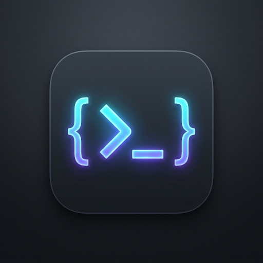

# T3 Code for Home Assistant (`t3-ha-app`)

<div align="center">
  
  <h2>T3 Code Home Assistant Add-on</h2>
  <p><b>Lightweight AI-Assisted Coding Terminal, T3 Code Server, T3 Connect Remote Access & GitHub CLI</b></p>

  [](https://my.home-assistant.io/redirect/supervisor_add_addon_repository/?repository_url=https%3A%2F%2Fgithub.com%2Fmarcohald%2Ft3-ha-app)
  [](https://github.com/marcohald/t3-ha-app/actions/workflows/builder.yaml)
</div>

---

## ✨ Key Features

- 📱 **T3 Code Server with 1-Click Mobile Companion Pairing**:
  - Automatically runs `t3 serve --lan --port 3774` on container startup.
  - Pair directly with the official **T3 Code** companion app for **iOS** (App Store) and **Android** (Google Play).
  - Built-in Ingress pairing modal featuring real-time generated vector QR codes, direct app deep links, and token refresh.
- 🌐 **T3 Connect Cloudflare Remote Access Relay**:
  - Full support for the **T3 Connect** secure relay service (`relay.t3.codes`).
  - Access your Home Assistant coding environment remotely from anywhere without opening firewall or router ports.
  - Interactive management from the Ingress toolbar or directly inside the terminal (`t3 connect status`).
- 🐙 **Integrated GitHub CLI (`gh`)**:
  - Pre-installed official GitHub CLI binary.
  - Clone repositories, push commits, and manage pull requests right from your Home Assistant terminal (`gh auth login`).
- 🪶 **Optimized Multi-Arch Container Architecture**:
  - Multi-architecture container images (`amd64` and `aarch64` / ARM64) built automatically via GitHub Actions CI.
  - Lightweight base image with minimal memory and disk footprint.
- 🔌 **Home Assistant Domotics & MCP Bridges**:
  - Pre-configured Model Context Protocol (MCP) server endpoints for **Home Assistant Core** and **Zigbee2MQTT**.
  - Direct read/write access to `/config` and `/share` via `/homeassistant`.
- 🖥️ **Streamlined Ingress Terminal UI**:
  - Integrated directly into the Home Assistant sidebar.
  - Multi-session persistent terminal tabs powered by `tmux` (sessions remain active across browser disconnects).
  - Virtual D-Pad navigation (Up, Down, Left, Right, Enter) optimized for touchscreen use.
  - Cleaned, modern top toolbar with fast key shortcuts (`Esc`, `Tab`, `^O`, `🔑 Login`, `🌐 T3 Connect`, `📱 Pair`, `🎮 D-Pad`).
  - Instant dark, light, and auto themes synchronized with your Home Assistant palette.

---

## 🚀 Installation & Add-on Store Setup

### Option 1: 1-Click Store Button (Recommended)
Click the button below to add this repository directly to your Home Assistant Add-on Store:

[](https://my.home-assistant.io/redirect/supervisor_add_addon_repository/?repository_url=https%3A%2F%2Fgithub.com%2Fmarcohald%2Ft3-ha-app)

### Option 2: Manual Repository Addition
1. Open your Home Assistant instance.
2. Go to **Settings** > **Add-ons** > **Add-on Store**.
3. In the top-right corner, click the three dots (**⋮**) > **Repositories**.
4. Add the repository URL:
   ```
   https://github.com/marcohald/t3-ha-app
   ```
5. Click **Add**, then close the dialog.
6. Locate **T3 Code** under the repository list, click **Install**, and toggle **Show in sidebar**.

---

## 📱 Mobile Companion App Pairing

1. Install **T3 Code** on your iOS or Android device.
2. Connect your mobile device to your home Wi-Fi network.
3. Open **T3 Code** from the Home Assistant sidebar.
4. Click the **📱 Pair** button in the top toolbar.
5. Scan the QR code or tap **Copy** to import your credentials into the mobile app.

---

## 🌐 Remote Access with T3 Connect

To connect to your T3 Code instance securely from outside your home network:
1. Open the terminal inside the add-on.
2. Run:
   ```bash
   t3 connect
   ```
3. Complete the quick one-time browser authentication.
4. Monitor tunnel status at any time by clicking **🌐 T3 Connect** in the toolbar or executing `t3 connect status`.

---

## ⚙️ Configuration Reference

| Option | Type | Default | Description |
|---|---|---|---|
| `port` | integer | `3774` | LAN port used by the T3 Code server for local network discovery and companion app pairing. |
| `ha_token` | string | *empty* | Long-lived access token for Home Assistant Core MCP integration. |
| `mqtt_host` | string | *empty* | MQTT Broker address (e.g. `core-mosquitto`) for Zigbee2MQTT MCP integration. |
| `mqtt_port` | string | `1883` | MQTT Broker port. |
| `mqtt_user` | string | *empty* | MQTT username. |
| `mqtt_pass` | password | *empty* | MQTT password. |

---

## 💾 Data Persistence & Architecture

In strict accordance with the [Home Assistant Add-on Developer Documentation](https://developers.home-assistant.io/docs/add-ons/presentation#data-directory):
- All persistent configuration, keys, session tokens, and T3 data are stored inside `/data` (specifically `/data/.t3`).
- Host storage is mapped persistently to the add-on data volume across updates and restarts.
- The working environment workspace `/homeassistant` links directly to Home Assistant `/config` and `/share`.

---

## 📁 Repository Structure

```
├── .github/
│   └── workflows/
│       └── builder.yaml     # Multi-arch GitHub Actions CI builder (amd64, aarch64)
├── config.yaml              # Home Assistant add-on specification
├── build.yaml               # Multi-architecture container build configuration
├── repository.yaml          # Add-on store repository manifest (YAML)
├── repository.json          # Add-on store repository manifest (JSON)
├── Dockerfile               # Production container definition
├── run.sh                   # Main container entrypoint & service orchestration
├── attach.sh                # Multi-session tmux terminal handler
├── welcome.sh               # Terminal welcome banner
├── tmux.conf                # Touchscreen-optimized tmux configuration
├── nginx.conf               # High-performance Ingress proxy & WebSocket relay
├── upload.py                # Companion pairing API, QR code engine, & T3 Connect hooks
├── html/
│   ├── index.html           # Modern responsive Ingress web interface
│   └── logo.png             # UI header logo
├── icon.png                 # Add-on store square icon (512x512)
├── logo.png                 # Add-on store banner logo (512x512)
└── translations/            # English and German UI localized strings
    ├── en.yaml
    └── de.yaml
```

---

<div align="center">
  <i>Built with ❤️ for Home Assistant & T3 Code</i>
</div>
